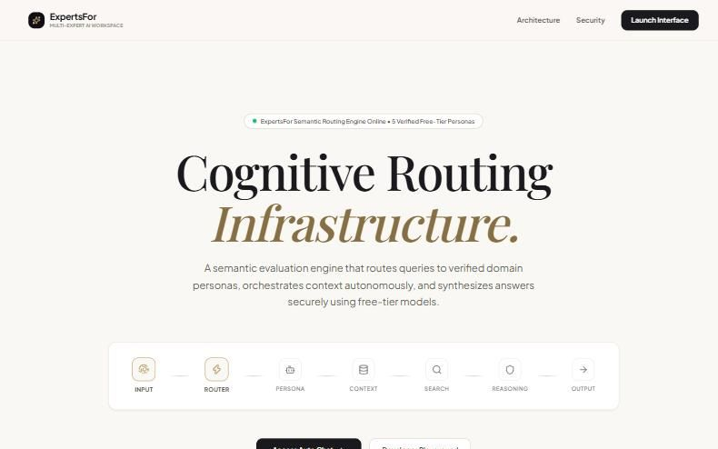
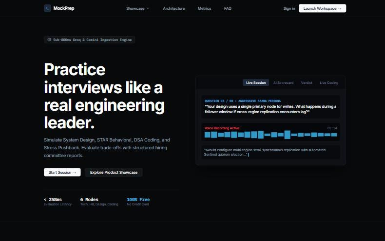
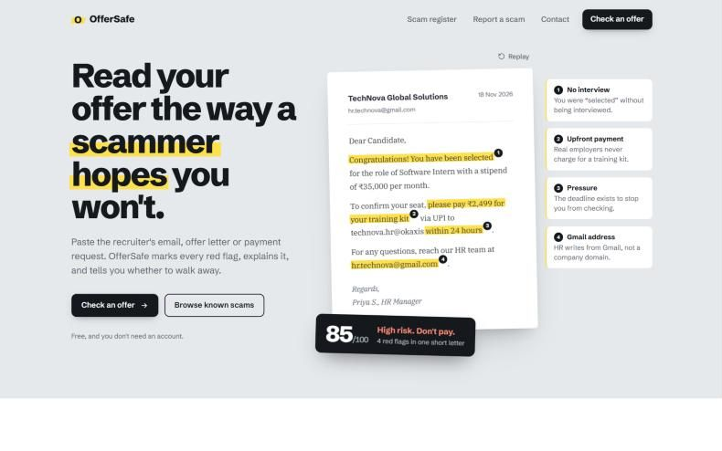

<picture>
  <source media="(max-width: 600px) and (prefers-color-scheme: dark)" srcset="assets/system-mobile-dark.svg">
  <source media="(max-width: 600px)" srcset="assets/system-mobile-light.svg">
  <source media="(prefers-color-scheme: dark)" srcset="assets/system-dark.svg">
  
</picture>

I'm Ronack. I build Python backends and LLM agent systems, mostly the parts that decide which model answers a question, check what comes in, and keep a record of what happened. I'm doing an MCA at SRM Institute of Science and Technology in Chennai (2025 to 2027, CGPA 9.12), and I'm looking for backend and AI internships and full-time roles from 2027.

## Projects

<table>
  <tr>
    <td width="50%" valign="top">
      
      <h3><a href="https://github.com/Ronack-Kumar/expertsfor">ExpertsFor</a></h3>
      
Sends each question to the right expert persona and model. The router was 84% accurate on a held-out benchmark. It works with six LLM providers, and the backend has 96 tests running in CI.

      Python, FastAPI, LangGraph, PostgreSQL with pgvector 
      <a href="https://expertsfor.me/">expertsfor.me</a>
    </td>
    <td width="50%" valign="top">
      
      <h3><a href="https://github.com/Ronack-Kumar/mockprep">MockPrep</a></h3>
      
Mock interviews for technical, HR and case-study rounds. You answer by text, voice or webcam, and each answer is scored on accuracy, clarity, depth and confidence.

      Next.js, Groq (Llama 3.3 70B), Supabase 
      <a href="https://www.mockprep.app/">mockprep.app</a>
    </td>
  </tr>
  <tr>
    <td width="50%" valign="top">
      
      <h3><a href="https://github.com/Ronack-Kumar/OfferSafe">OfferSafe</a></h3>
      
Checks job and internship offers for scam signs. It scores 19 weighted risk signals, adds a Gemini and Groq review, and keeps a community list of reported scams.

      TypeScript, Next.js, Supabase 
      <a href="https://offer-safe.vercel.app/">offer-safe.vercel.app</a>
    </td>
    <td width="50%" valign="top">
      <a href="https://github.com/Ronack-Kumar/finance-workspace">
        <picture>
          <source media="(prefers-color-scheme: dark)" srcset="assets/finance-dark.svg">
          
        </picture>
      </a>
      <h3><a href="https://github.com/Ronack-Kumar/finance-workspace">Finance Workspace</a></h3>
      
Shared finance workspaces where a team records income and spending in rupees. Members get role-based access, amounts stay exact, and 12 automated test scenarios cover the flows.

      TypeScript, Express, Prisma, SQLite
    </td>
  </tr>
</table>

## Inside ExpertsFor

<picture>
  <source media="(max-width: 600px) and (prefers-color-scheme: dark)" srcset="assets/expertsfor-mobile-dark.svg">
  <source media="(max-width: 600px)" srcset="assets/expertsfor-mobile-light.svg">
  <source media="(prefers-color-scheme: dark)" srcset="assets/expertsfor-dark.svg">
  
</picture>

I built this during my internship at 8 Queens Software, when it was still called GRID07. The router picks a persona and a model in about a millisecond, the API keys for each provider are stored encrypted, and every step of a run is saved so an answer can be traced back later.

## Experience

**8 Queens Software**, Software Developer Intern, Chennai (on-site), Aug to Sep 2026 
Built GRID07, now ExpertsFor, on LangGraph and FastAPI.

**B2World**, Software Developer Intern, remote, Jul to Aug 2026 
Worked on DriveLearn India, a platform for driving schools: role-based access, course management, bookings and analytics in React, Node.js and PostgreSQL.

**IT Developer**, MERN Full Stack Intern, Rourkela, Aug to Oct 2024 
Built a result management system on MongoDB, Express, React and Node.js, covering the frontend and the REST API.

## Stack

On the backend I use Python, FastAPI, LangGraph, SQLAlchemy and PostgreSQL. Web apps are TypeScript with Next.js, React and Node.js, and Docker and GitHub Actions handle builds and CI.

## Contact

Email me at [raunackbhardwaj1307@gmail.com](mailto:raunackbhardwaj1307@gmail.com), or find me on [LinkedIn](https://www.linkedin.com/in/ronackkumar/). My [resume](assets/Ronack_Kumar_Resume.pdf) and [portfolio](https://ronack-portfolio.netlify.app/) have more detail.
