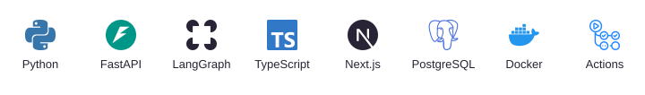

<picture>
  <source media="(max-width: 600px) and (prefers-color-scheme: dark)" srcset="assets/header-mobile-dark.svg">
  <source media="(max-width: 600px)" srcset="assets/header-mobile-light.svg">
  <source media="(prefers-color-scheme: dark)" srcset="assets/header-dark.svg">
  
</picture>

Backend and AI developer in **Chennai**. **MCA at SRM Institute of Science and Technology**, graduating **2027**, with a **9.08/10 CGPA**. I build **Python APIs, LangGraph agents, and full-stack applications**.

## How GRID07 works

A request-routing overview of the multi-agent platform I built at **8 Queens Software**.

<picture>
  <source media="(max-width: 600px) and (prefers-color-scheme: dark)" srcset="assets/workflow-mobile-dark.svg">
  <source media="(max-width: 600px)" srcset="assets/workflow-mobile-light.svg">
  <source media="(prefers-color-scheme: dark)" srcset="assets/workflow-dark.svg">
  
</picture>

<picture>
  <source media="(max-width: 600px) and (prefers-color-scheme: dark)" srcset="assets/metrics-mobile-dark.svg">
  <source media="(max-width: 600px)" srcset="assets/metrics-mobile-light.svg">
  <source media="(prefers-color-scheme: dark)" srcset="assets/metrics-dark.svg">
  
</picture>

## Selected projects

<table>
  <tr>
    <td width="50%" valign="top">
      <h3><a href="https://github.com/Ronack-Kumar/grid07">GRID07 &#8599;&#65038;</a></h3>
      
Expert routing across <strong>6 LLM integrations</strong>. LangGraph workflows, encrypted API keys, and <strong>84 backend tests</strong>.

      Python / FastAPI / LangGraph
    </td>
    <td width="50%" valign="top">
      <h3><a href="https://github.com/Ronack-Kumar/interviewai">InterviewAI &#8599;&#65038;</a></h3>
      
Text, voice, and webcam practice with <strong>four-dimension AI feedback</strong>, saved sessions, and peer rooms.

      Next.js / Groq / Supabase 
      <a href="https://interviewai-swart.vercel.app/">Try the app ↗</a>
    </td>
  </tr>
  <tr>
    <td width="50%" valign="top">
      <h3><a href="https://github.com/Ronack-Kumar/OfferSafe">OfferSafe &#8599;&#65038;</a></h3>
      
Job-offer checks using <strong>19 weighted risk signals</strong>, Gemini/Groq analysis, and community scam reports.

      TypeScript / Next.js / Supabase 
      <a href="https://offer-safe.vercel.app/">Try the app ↗</a>
    </td>
    <td width="50%" valign="top">
      <h3><a href="https://github.com/Ronack-Kumar/finance-backend">Finance API &#8599;&#65038;</a></h3>
      
JWT authentication, <strong>role-based permissions</strong>, financial records, and analytics for a finance dashboard.

      Python / FastAPI / SQLAlchemy
    </td>
  </tr>
</table>

## Tools I use

<picture>
  <source media="(max-width: 600px) and (prefers-color-scheme: dark)" srcset="assets/stack-mobile-dark.svg">
  <source media="(max-width: 600px)" srcset="assets/stack-mobile-light.svg">
  <source media="(prefers-color-scheme: dark)" srcset="assets/stack-dark.svg">
  
</picture>

**Internships:** 8 Queens Software (GRID07), B2World (DriveLearn India), and IT Developer (MERN Result Management System).

---

Open to **backend and AI internships**, and **2027 full-time roles**.

[Portfolio](https://ronack-portfolio.netlify.app/) &nbsp; / &nbsp; [Resume](assets/Ronack_Kumar_Resume.pdf) &nbsp; / &nbsp; [LinkedIn](https://www.linkedin.com/in/ronackkumar/) &nbsp; / &nbsp; [Email](mailto:raunackbhardwaj1307@gmail.com)
